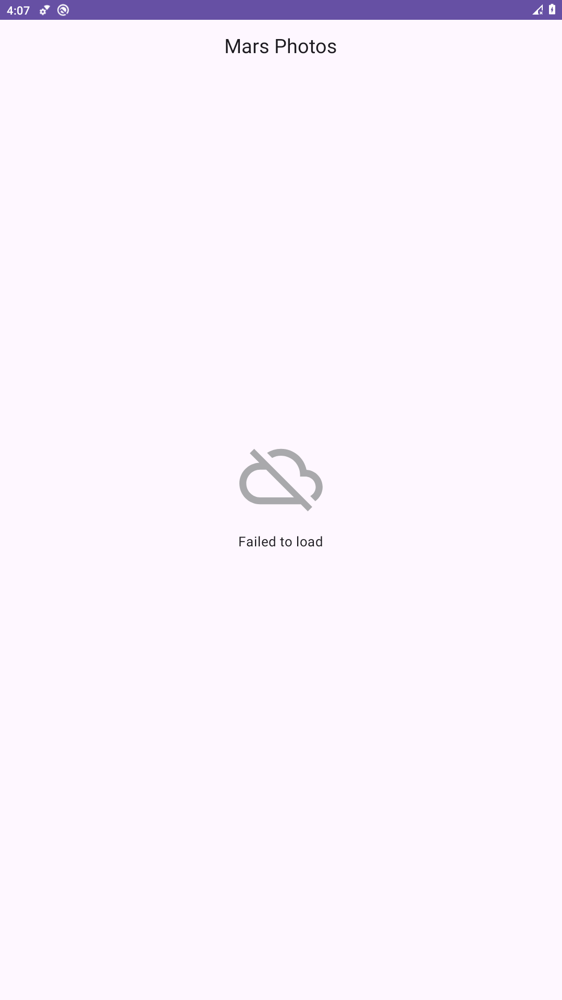
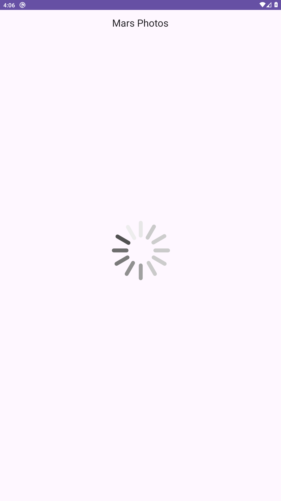

# Mars Photos App 🚀🔴

Aplicación nativa de Android desarrollada con **Kotlin** y **Jetpack Compose** para la materia **Aplicaciones Móviles Nativas** (Sexto Nivel - Ingeniería de Software). 

Esta práctica implementa paso a paso el codelab oficial de Google Android Developers: **[Cómo obtener datos de Internet](https://developer.android.com/codelabs/basic-android-kotlin-compose-getting-data-internet?hl=es-419)** (*Android Basics with Compose*).

---

## 📖 Descripción del Proyecto

**Mars Photos** se conecta mediante solicitudes HTTP a un servicio web REST en tiempo real alojado en Google Cloud (`https://android-kotlin-fun-mars-server.appspot.com/photos`), el cual suministra información y fotografías reales de la superficie de Marte capturadas por los rovers de la NASA.

La aplicación descarga la respuesta en formato JSON, la analiza y deserializa en objetos Kotlin (`MarsPhoto`) de manera asíncrona mediante corrutinas, y gestiona de forma reactiva los diferentes estados de la interfaz de usuario (Carga, Éxito y Error).

---

## 📱 Evidencias de la App en Funcionamiento

| Estado de Éxito (`MarsUiState.Success`) | Estado de Error / Sin conexión (`MarsUiState.Error`) | Estado de Carga (`MarsUiState.Loading`) |
| :---: | :---: | :---: |
|  |  |  |
| **838 registros de fotos de Marte recuperados** | **Control de fallos de red sin cierres inesperados** | **Indicador de carga durante la petición** |

---

### Capturas verificadas en ejecución real

Las tres imágenes anteriores fueron capturadas directamente del emulador **Cupcake_API29 (Android 10, API 29, x86_64, 1080 × 1920)** el **11 de noviembre de 2026 (Ecuador, UTC−5)**, sin editar su contenido. El reloj de la barra del emulador usa UTC.

- **Éxito:** inicio con conexión; mensaje observado `Success: 838 Mars photos retrieved`.
- **Carga:** reinicio con la red del emulador temporalmente ralentizada (retardo de 5000 ms y velocidad GSM), sin modificar el código.
- **Error:** Wi-Fi y datos móviles deshabilitados; mensaje observado `Failed to load`.
- **Recuperación:** conexión restablecida y reinicio; se verificaron nuevamente 838 registros. Esta versión no tiene botón de reintento.

El alcance de este codelab es mostrar la **cantidad de registros**, no la galería de imágenes, que se desarrolla en un codelab posterior. Las 838 entradas corresponden a la respuesta observada y pueden variar si cambia el servidor.

**[Descargar informe editable en Word](docs/Evidencias_Mars_Photos.docx)** · [Procedimiento y huellas de las capturas](screenshots/README.md)

Validación: `gradlew.bat assembleDebug` con **JDK 17** → `BUILD SUCCESSFUL`. Si el JDK incluido en una versión más reciente de Android Studio es incompatible con Gradle 8.12, selecciona JDK 17 para Gradle.

---

## 🛠️ Arquitectura y Componentes Clave

1. **Permiso de Internet (`AndroidManifest.xml`):**
   * Declaración del permiso normal `<uses-permission android:name="android.permission.INTERNET" />` para permitir que la app abra sockets de red.
2. **Cliente de Red con Retrofit 2 y OkHttp (`MarsApiService.kt`):**
   * Configuración de `Retrofit.Builder()` con URL base y fábrica de convertidores `Json.asConverterFactory("application/json".toMediaType())`.
   * Interfaz `MarsApiService` con función de suspensión asíncrona:
     ```kotlin
     @GET("photos")
     suspend fun getPhotos(): List<MarsPhoto>
     ```
   * Declaración del patrón Singleton mediante `object MarsApi` con inicialización diferida (`by lazy`), evitando instancias redundantes.
3. **Deserialización con Kotlinx Serialization (`MarsPhoto.kt`):**
   * Clase de datos anotada con `@Serializable` para transformar el array JSON a una lista de objetos Kotlin fuertemente tipados.
   * Uso de `@SerialName(value = "img_src") val imgSrc: String` para mapear el campo en formato snake_case del servidor a la convención camelCase recomendada en Kotlin.
4. **Gestión de Estados con Sealed Interface (`MarsViewModel.kt`):**
   * Interfaz sellada para restringir y hacer exhaustivos los estados de la UI:
     ```kotlin
     sealed interface MarsUiState {
         data class Success(val photos: String) : MarsUiState
         object Error : MarsUiState
         object Loading : MarsUiState
     }
     ```
   * Solicitud asíncrona desde `viewModelScope.launch` con la función suspendida de Retrofit, sin bloquear el hilo principal.
   * Manejo robusto de excepciones en tiempo de ejecución (`IOException` y `HttpException`) mediante bloques `try-catch`.
5. **Capa de Presentación Declarativa (`HomeScreen.kt`):**
   * Renderizado condicional mediante expresión `when (marsUiState)` que despliega `LoadingScreen`, `ResultScreen` o `ErrorScreen` según corresponda.

---

## 🧰 Tecnologías y Bibliotecas

* **Lenguaje:** Kotlin 2.1.0
* **Framework de Interfaz:** Jetpack Compose con Material 3
* **Arquitectura:** MVVM (Model-View-ViewModel) con Unidirectional Data Flow (UDF)
* **Cliente HTTP:** Retrofit 2 (`2.9.0`) & OkHttp 3 (`4.11.0`)
* **Conversión y Parsing:** Kotlinx Serialization JSON (`1.6.0`) y `retrofit2-kotlinx-serialization-converter` (`1.0.0`)
* **Asincronía:** Kotlin Coroutines (`viewModelScope`)
* **Herramienta de Compilación:** Gradle 8.12 con Android Gradle Plugin 8.8.0

---

## 🚀 Cómo Ejecutar el Proyecto

1. Clona el repositorio:
   ```bash
   git clone https://github.com/Erickelrojo-22/Mars-Photos-App.git
   ```
2. Abre la carpeta del proyecto en **Android Studio** (Ladybug o superior recomendado).
3. Permite que Gradle sincronice las dependencias del proyecto.
4. Selecciona un emulador Android (API 24+) o un dispositivo físico conectado con depuración USB habilitada.
5. Presiona **Run** (`Shift + F10`) para compilar y ejecutar la app.

---

## 👤 Autor

* **Estudiante:** Erick Alexander Moreira Bailón
* **Carrera:** Ingeniería de Software
* **Materia:** Aplicaciones Móviles Nativas (Sexto Nivel)
* **GitHub:** [@Erickelrojo-22](https://github.com/Erickelrojo-22)
