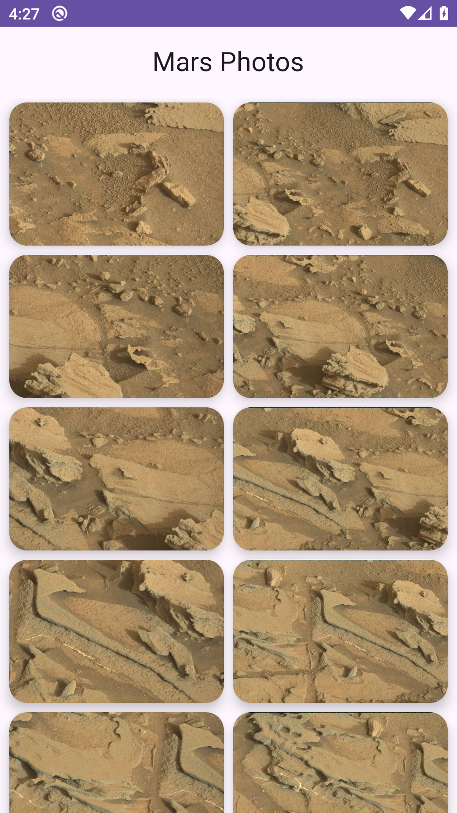
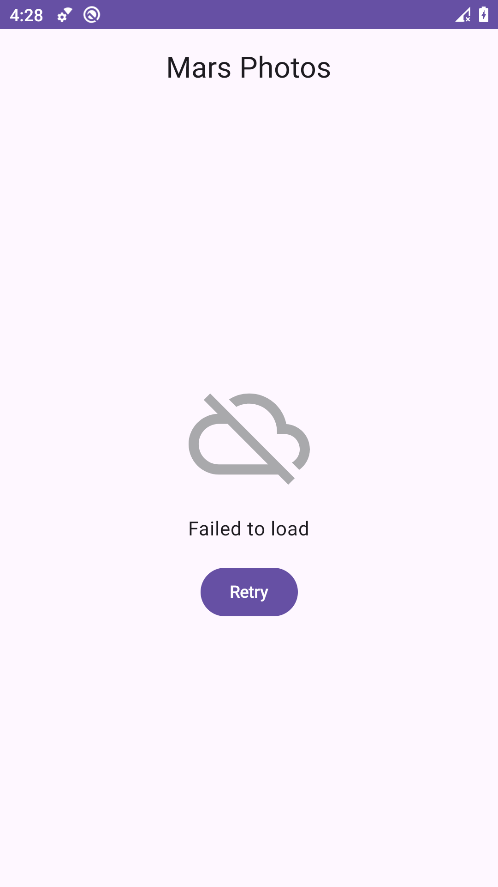
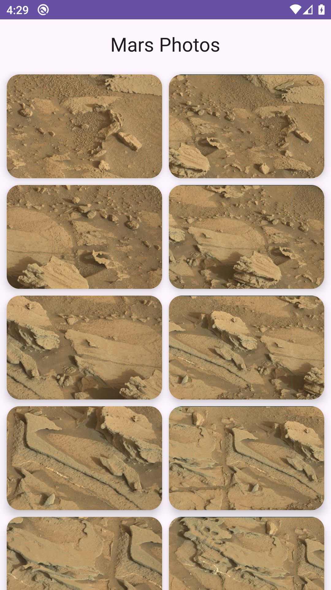
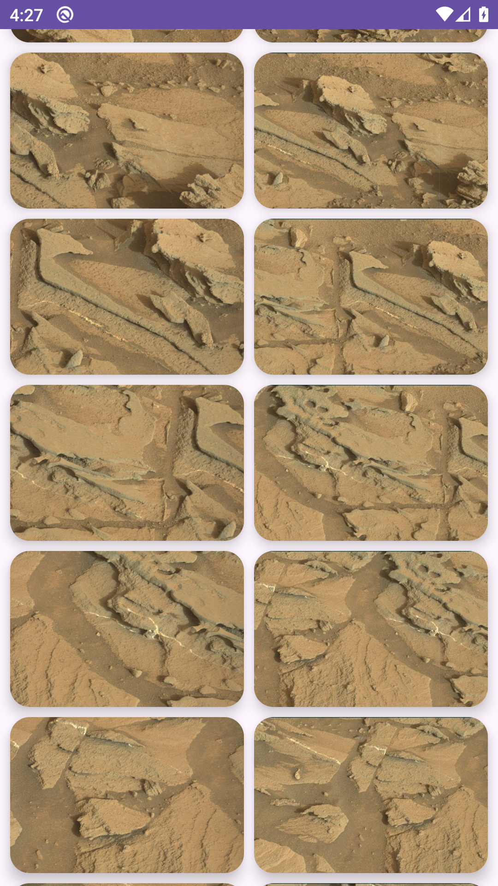
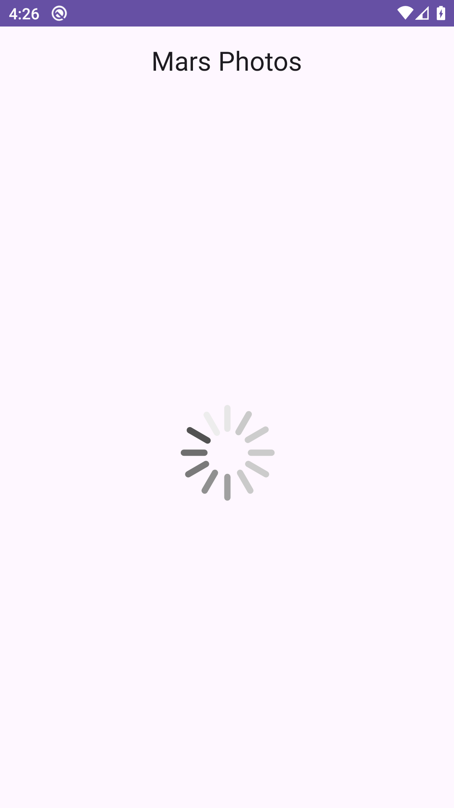
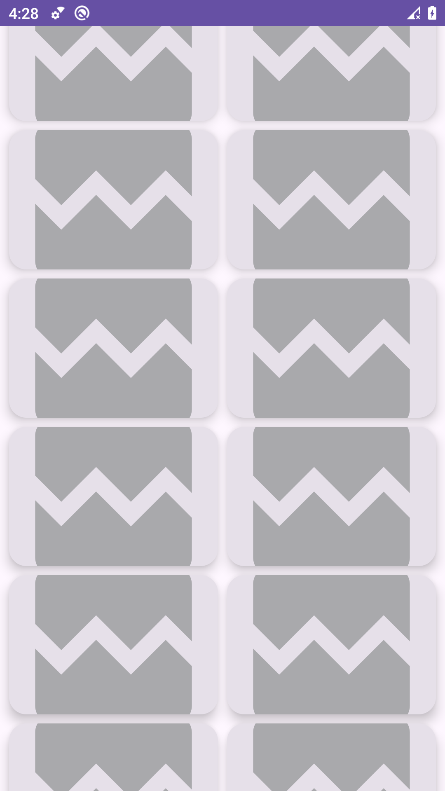

# Mars Photos App

Aplicación Android desarrollada con **Kotlin y Jetpack Compose** para Aplicaciones Móviles Nativas, sexto nivel de Ingeniería de Software.

La versión actual obtiene los datos de Marte mediante Retrofit y Kotlinx Serialization, los expone a través de un repositorio con inyección manual de dependencias y descarga las fotografías con **Coil** para mostrarlas en una cuadrícula adaptable. Incluye carga, errores de red, imágenes no disponibles y un botón **Retry**.

## Codelabs completados

Se usa el mismo repositorio porque las tres prácticas continúan la misma aplicación. Cada etapa conserva su implementación en el historial:

| Etapa | Práctica oficial | Versión |
| --- | --- | --- |
| 1 | [Obtener datos de Internet](https://developer.android.com/codelabs/basic-android-kotlin-compose-getting-data-internet) | [Contador de registros y evidencias iniciales](https://github.com/Erickelrojo-22/Mars-Photos-App/tree/f8734b4499ae51952c4aee4244a071af3b932711) |
| 2 | [Agregar repositorio e inyección manual](https://developer.android.com/codelabs/basic-android-kotlin-compose-add-repository) | [Repositorio, contenedor y pruebas](https://github.com/Erickelrojo-22/Mars-Photos-App/tree/4eb7a1ea4c1574aae999ed4f79fffa803033f912) |
| 3 | [Cargar y mostrar imágenes de Internet](https://developer.android.com/codelabs/basic-android-kotlin-compose-load-images) | [Galería con Coil y reintento](https://github.com/Erickelrojo-22/Mars-Photos-App/tree/ce100ef1b7035ad11e10ee2bebe80010069f2253) |

## Informe editable y evidencias reales

**[Descargar Word de las dos continuaciones](docs/Evidencias_Mars_Photos_Continuacion.docx)**

El informe contiene las evidencias de la app ejecutada, el resultado de las pruebas, la explicación de cada codelab y el enlace a este repositorio.

Capturas realizadas el **13 de noviembre de 2026**, directamente en **Cupcake_API29, Android 10 API 29, x86_64**. Las imágenes no están retocadas y corresponden a la aplicación instalada; las fotografías se descargaron del servicio real.

| Galería con fotografías | Error con Retry | Recuperación al pulsar Retry |
| :---: | :---: | :---: |
|  |  |  |

| Repositorio e inyección manual | Desplazamiento | Carga | Imágenes sin conexión |
| :---: | :---: | :---: | :---: |
|  |  |  |  |

[Procedimiento y huellas de las capturas](screenshots/continuacion/README.md) · [Resultados de validación](docs/Validacion_Continuacion.md)

## Arquitectura

```text
MarsPhotosApplication
  └─ DefaultAppContainer
       └─ NetworkMarsPhotosRepository ← MarsApiService / Retrofit
            └─ MarsViewModel (Factory e inyección por constructor)
                 └─ HomeScreen
                      ├─ LoadingScreen
                      ├─ PhotosGridScreen → MarsPhotoCard / AsyncImage
                      └─ ErrorScreen → Retry
```

- `data/MarsPhotosRepository.kt`: contrato de acceso a los datos y repositorio de red.
- `data/AppContainer.kt`: crea Retrofit y mantiene las dependencias compartidas mediante inicialización diferida.
- `MarsPhotosApplication.kt`: inicializa el contenedor y está registrada en el manifiesto.
- `network/MarsApiService.kt`: solicitud suspendida `GET photos`.
- `model/MarsPhoto.kt`: modelo serializable y mapeo de `img_src` a `imgSrc`.
- `ui/screens/MarsViewModel.kt`: estados Loading, Success con `List<MarsPhoto>` y Error; consulta mediante `viewModelScope` y manejo de `IOException` y `HttpException`.
- `ui/screens/HomeScreen.kt`: cuadrícula con `GridCells.Adaptive(150.dp)`, claves por ID, tarjetas con proporción 1,5 y elevación de 8 dp; Coil con crossfade, placeholder e imagen de error; acción Retry.

El servicio utilizado es `https://android-kotlin-fun-mars-server.appspot.com/photos`. La ejecución de la etapa con repositorio recuperó **838 registros**; la cantidad puede variar si cambia el servidor. La versión final muestra las fotografías en lugar del contador.

## Tecnologías

Kotlin 2.1.0, Jetpack Compose con Material 3, Retrofit 2.9.0, OkHttp 4.11.0, Kotlinx Serialization JSON 1.6.0, Coil Compose 2.4.0, JUnit 4.13.2 y Kotlin Coroutines Test 1.9.0. Compilación con Gradle 8.12 y Android Gradle Plugin 8.8.0.

## Ejecutar y verificar

1. Clonar el proyecto:
   ```bash
   git clone https://github.com/Erickelrojo-22/Mars-Photos-App.git
   ```
2. Abrirlo en Android Studio y seleccionar **JDK 17** para Gradle.
3. Sincronizar las dependencias y ejecutar en un emulador o dispositivo **API 24 o superior**, con conexión a Internet.
4. Para compilar, ejecutar las pruebas y analizar el proyecto desde PowerShell:
   ```powershell
   .\gradlew.bat testDebugUnitTest assembleDebug lintDebug
   ```

**Validación realizada:** `BUILD SUCCESSFUL`, **7 pruebas, 0 fallos y 0 errores**. Android Lint terminó sin errores y con 11 advertencias sobre versiones de dependencias y elementos de la plantilla.

Las pruebas usan `FakeDataSource`, `FakeMarsApiService`, `FakeNetworkMarsPhotosRepository` y `TestDispatcherRule`. Comprueban la lista devuelta por el repositorio, la propagación de errores, los estados del ViewModel y la recuperación tras un fallo. Las pruebas de red visibles se realizaron aparte con la app instalada.

Para reproducir las evidencias de error, deshabilitar Wi-Fi y datos del dispositivo. Desplazarse a fotografías aún no almacenadas en caché para observar sus iconos de error. Reiniciar sin red para ver `Failed to load`; restablecer la conexión y pulsar **Retry** para recuperar la galería.

## Evidencias de la práctica anterior

Se conservan el [Word inicial](docs/Evidencias_Mars_Photos.docx), las [capturas iniciales](screenshots/README.md) y su [versión del proyecto](https://github.com/Erickelrojo-22/Mars-Photos-App/tree/f8734b4499ae51952c4aee4244a071af3b932711).

## Autor

**Erick Alexander Moreira Bailón** · Ingeniería de Software · Aplicaciones Móviles Nativas, sexto nivel.

GitHub: [Erickelrojo-22](https://github.com/Erickelrojo-22)
